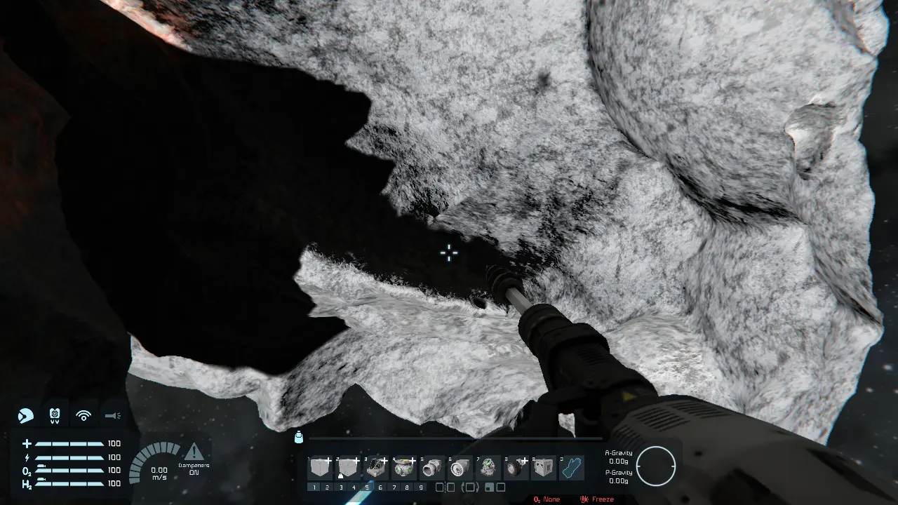
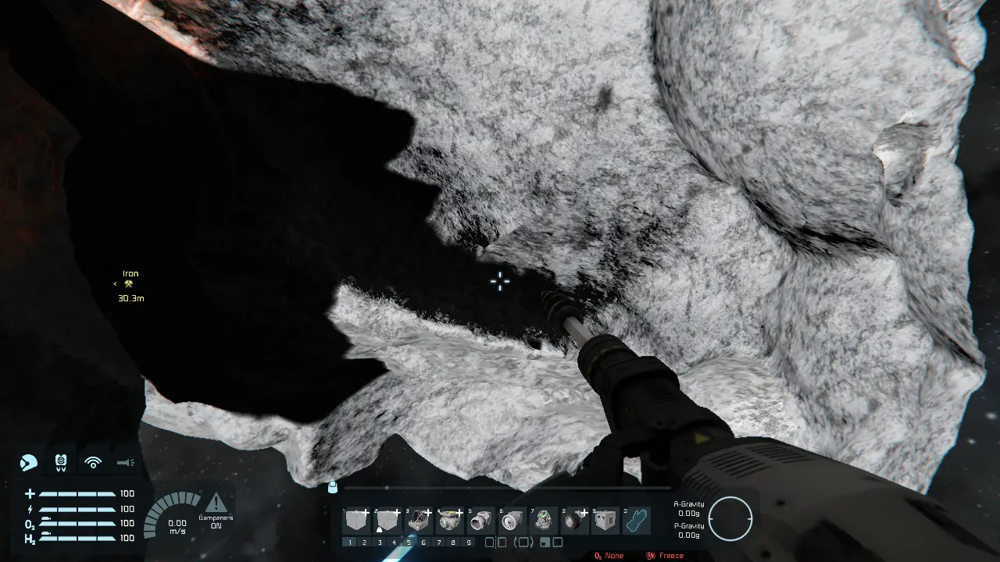

# Ore markers on rotated asteroids

A hand drill held next to exposed iron can show no ore marker. Grid detectors use the same client-side search.

`MyOreDepositGroup.UpdateDeposits` subtracts the voxel map's world-space corner from each search bound. On a rotated asteroid, the resulting coordinates still point along the world axes. The game can end up sampling a different part of the asteroid or clamping the search to its outermost cells. On Octahedron seed 2, the center of the search beside asteroid 0348 was about 481 m off in storage coordinates.

The patch transforms the offset from the asteroid's corner to the detector into storage axes. The game then applies the detector radius along those axes and uses its existing code to query cells and place the HUD marker.

## Regression test

An isolated Linux client loaded a copy of asteroid 0348 with its original orientation and seed 2 ore definitions. At the same position, the hand drill registered zero ore-bearing cells with the fix disabled and five iron-bearing cells with it enabled. The rendered HUD displayed **Iron** at approximately 30 m.

A pilot seated in a powered large-grid detector ship at the same test asteroid also saw the difference. With the detector set to 100 m, its HUD registered zero cells with the fix disabled and ten with it enabled, containing iron and silicon.

Run the regression against an offline test client with the fix disabled, then restart with it enabled and run it again. The script takes the Remote URL and the expected mode (`before` or `after`). [Hand drill regression test](../tests/rotated-asteroid-ore/check.py)

| Fix disabled | Fix enabled |
| --- | --- |
|  |  |
